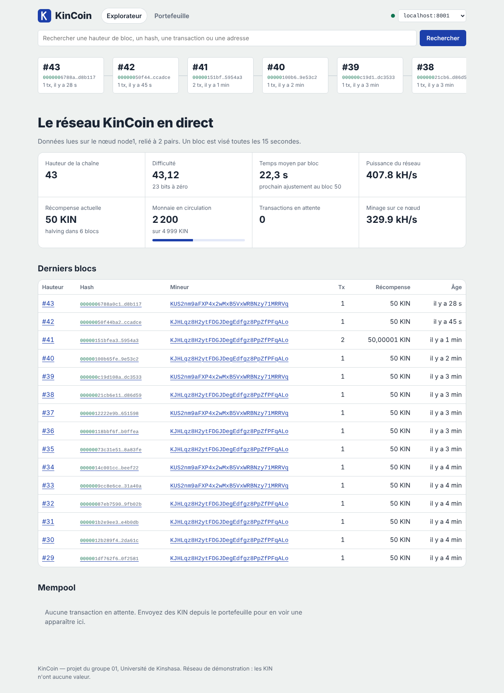
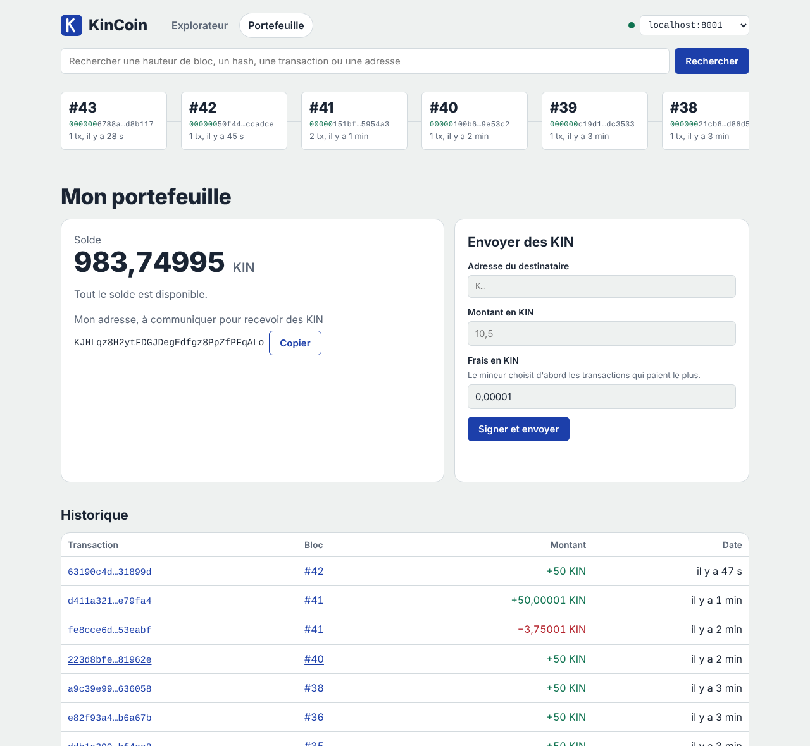
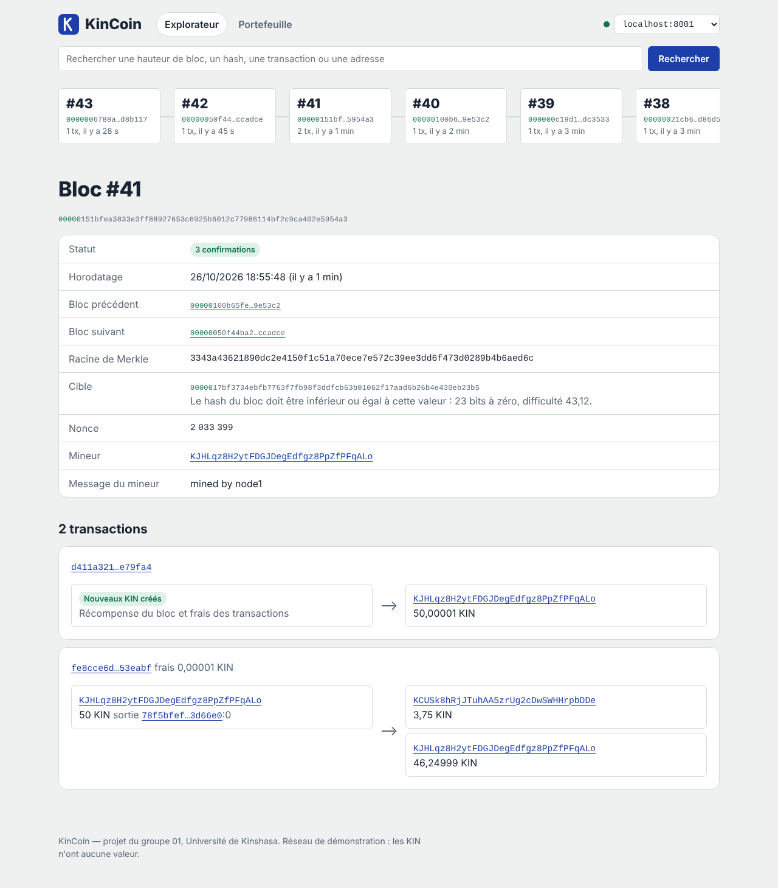
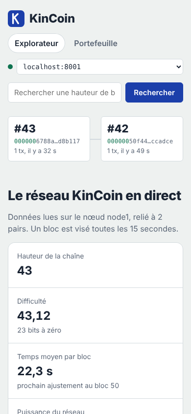
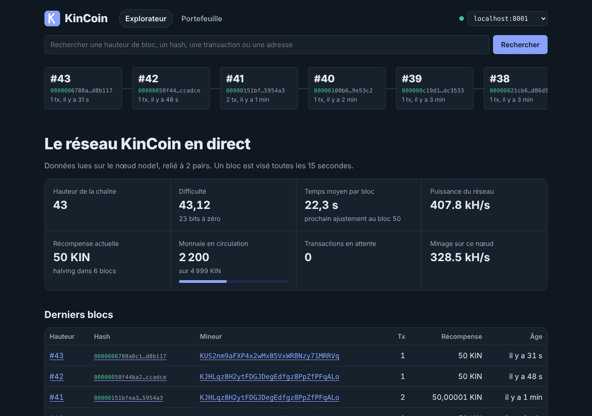

# KinCoin

Cryptomonnaie à preuve de travail avec sa propre blockchain, codée par le groupe, déployée sur un réseau privé accessible en ligne, avec un portefeuille web, un explorateur de blocs et une API documentée.

## Liens de remise

> À compléter après le déploiement, puis à vérifier en navigation privée.

## Membres du groupe 01

- Akossa Dole Elvis
- Massevo Lenzo Delss
- Nimy Bianga Descartes
- Nzau Umba Jeanson

Université de Kinshasa, Faculté des Sciences.

## Objectifs

Concevoir une cryptomonnaie complète sans tiers de confiance :

- une blockchain codée par le groupe : blocs chaînés par SHA-256, transactions signées ECDSA secp256k1, modèle UTXO, arbre de Merkle ;
- un minage par preuve de travail avec ajustement automatique de la difficulté, récompense et halving ;
- un réseau pair-à-pair d'au moins trois nœuds, hébergé en ligne ;
- un portefeuille web qui signe les transactions dans le navigateur, un explorateur de blocs et une API REST documentée ;
- des tests automatisés et une analyse de sécurité.

## Identifiants du réseau (équivalent des adresses de contrats)

KinCoin n'est pas un contrat intelligent déployé sur une chaîne existante : c'est sa propre blockchain. Le réseau est identifié par :

| Élément | Valeur |
| --- | --- |
| Hash du bloc genèse | `0c5171a93f8e55c84fac5cb5317cf2d842b65267483c6045c79c816ccc353b19` |
| Message du bloc genèse | `Kinshasa 26/10/2026 - KinCoin, projet Groupe 01, UNIKIN` |
| Préfixe des adresses | `K` (octet de version 0x2D) |
| Unité | 1 KIN = 100 000 000 makuta |
| Paramètres | bloc visé toutes les 15 s, difficulté ajustée tous les 10 blocs, 50 KIN par bloc, halving tous les 50 blocs |

Un nœud dont le bloc 0 (`GET /block/0`) n'a pas ce hash appartient à un autre réseau.

## Comptes de démonstration

Réseau de test : ces KIN n'ont aucune valeur, ces clés ne doivent servir qu'à la démonstration.

| Compte | Adresse | Clé privée (à importer dans le portefeuille) |
| --- | --- | --- |
| Alice (reçoit les récompenses du nœud 1) | `KDuuTP3fHBzUzq8BGXZPZcV6YuKFGLmeJ7` | `3a44682bb9237b6af6dc9e391e25b5df7046997cc4f042a49d11b420a55b113c` |
| Bob | `KWVCdwtz92WvoorA4toQ8pEBHTgcRn9raU` | `50949db1133c76996ec9df0d0b499804489128e24cf379a2a0f691aee925b143` |

Pour qu'Alice ait des KIN, le nœud 1 est déployé avec `MINER_ADDRESS=KDuuTP3fHBzUzq8BGXZPZcV6YuKFGLmeJ7`. Dans l'application, onglet **Portefeuille** → **Importer une clé**, coller la clé d'Alice, puis envoyer des KIN à l'adresse de Bob.

## Captures d'écran

| Explorateur | Portefeuille |
| --- | --- |
|  |  |

| Détail d'un bloc | Téléphone | Mode sombre |
| --- | --- | --- |
|  |  |  |

## Architecture

```
Navigateur (portefeuille + explorateur, frontend/ sur Vercel)
   │  HTTPS : API REST (/tx, /info, /block, /address…)
   ▼
Nœud 1 (mineur) ◄──WebSocket /p2p──► Nœud 2 (mineur)
      ▲                                   ▲
      └──────────WebSocket /p2p──────► Nœud 3 (validateur)
```

- **Sur la chaîne** : blocs, transactions signées, coinbases (récompenses), racine de Merkle, difficulté. Aucune donnée personnelle : seulement des adresses pseudonymes et des montants.
- **Hors chaîne** : clé privée (dans le navigateur de l'utilisateur), mempool (transactions en attente, en mémoire), configuration des nœuds (variables d'environnement), interface web.
- Un seul module, `chain.py`, décide de ce qui est valide ; le réseau, le mineur et l'API lui soumettent tout.

```
kincoin/
  params.py     paramètres du protocole (temps de bloc, récompense, halving…)
  crypto.py     SHA-256, ECDSA secp256k1, adresses Base58Check, JSON canonique
  merkle.py     arbre de Merkle et preuves d'inclusion
  tx.py         format des transactions, signature, construction
  block.py      blocs, bloc genèse, recherche du nonce
  chain.py      validation, ensemble UTXO, mempool, forks et réorganisations, persistance
  miner.py      fil de minage
  p2p.py        réseau pair-à-pair (WebSocket ou HTTP)
  node.py       API REST FastAPI qui assemble le tout
  wallet.py     portefeuille en ligne de commande (secours)
frontend/       portefeuille + explorateur, site statique (Vercel)
tests/          tests automatisés
deploy/oracle/  déploiement sur une VM Oracle Cloud avec HTTPS
docs/           livre blanc, guide de démonstration, captures
```

Documents : [livre blanc et tokenomics](docs/livre-blanc.md), [guide de démonstration](docs/guide-demo.md).

## Installation

**Windows** : installer Python 3.13 (cocher « Add python.exe to PATH »), puis double-cliquer sur `installer.bat`, puis sur `lancer.bat`. L'application s'ouvre sur http://127.0.0.1:8001/app/.

**Docker** :

```bash
docker compose up --build
```

**Python** (3.11 ou plus) :

```bash
pip install -r requirements.txt
DATA_DIR=data/1 PUBLIC_URL=http://localhost:8001 PEERS=http://localhost:8002,http://localhost:8003 MINING=1 FRONTEND_DIR=frontend uvicorn kincoin.node:app --port 8001
DATA_DIR=data/2 PUBLIC_URL=http://localhost:8002 PEERS=http://localhost:8001,http://localhost:8003 MINING=1 uvicorn kincoin.node:app --port 8002
DATA_DIR=data/3 PUBLIC_URL=http://localhost:8003 PEERS=http://localhost:8001,http://localhost:8002 uvicorn kincoin.node:app --port 8003
```

### Variables d'environnement d'un nœud

| Variable | Rôle | Défaut |
| --- | --- | --- |
| `NODE_NAME` | nom affiché dans l'explorateur | `kincoin-node` |
| `PEERS` | URL des autres nœuds, séparées par des virgules | aucun |
| `PUBLIC_URL` | URL publique de ce nœud (détectée sur Render et Fly.io) | aucune |
| `MINING` | `1` pour miner au démarrage | `0` |
| `MINER_ADDRESS` | adresse qui reçoit les récompenses | clé créée dans `DATA_DIR/node_key.json` |
| `ADMIN_TOKEN` | exigé (en-tête `X-Admin-Token`) pour `/mining/start`, `/mining/stop`, `POST /peers` | aucun (ouvert) |
| `P2P_TRANSPORT` | `ws` ou `http` | `ws` |
| `DATA_DIR` | dossier de la chaîne | `./data` |
| `FRONTEND_DIR` | sert le portefeuille sur `/app` | aucun |

## Déploiement en ligne

1. **Dépôt** : pousser ce dossier sur GitHub.
2. **Nœuds sur Render** : *New* → *Blueprint*, choisir le dépôt ; `render.yaml` crée les trois nœuds. Corriger `PEERS` de chaque service avec les URL réelles des deux autres, et mettre `MINER_ADDRESS` du nœud 1 à l'adresse d'Alice. Conseil : un compte Render par membre (750 heures gratuites par compte et par mois). Variante stable : les trois nœuds sur une VM Oracle Cloud avec `deploy/oracle/` (HTTPS automatique par Caddy).
3. **Interface sur Vercel** : remplacer dans `frontend/config.js` la liste des nœuds par leurs URL HTTPS :
   ```js
   window.KINCOIN_NODES = ["https://…-1.onrender.com", "https://…-2.onrender.com", "https://…-3.onrender.com"];
   ```
   puis *Add New* → *Project*, *Root Directory* = `frontend`.
4. **Vérification** en navigation privée : l'application s'ouvre, le point en haut à droite est vert, « relié à 2 pairs », un bloc arrive toutes les 15 à 30 s, un envoi d'Alice vers Bob est confirmé.

## API REST documentée

La documentation interactive est générée par FastAPI sur `/docs` de chaque nœud.

| Méthode et route | Réponse |
| --- | --- |
| `GET /info` | état du réseau : hauteur, difficulté, récompense, offre, pairs, minage |
| `GET /blocks?limit=20&before=N` | derniers blocs (résumés) |
| `GET /block/{hauteur ou hash}` | bloc complet avec ses transactions |
| `GET /tx/{txid}` | transaction, statut et confirmations |
| `GET /address/{adresse}` | solde, UTXO disponibles, historique |
| `GET /mempool` | transactions en attente |
| `POST /tx` | diffuse une transaction signée |
| `GET /search/{texte}` | identifie une hauteur, un hash, un txid ou une adresse |
| `GET /peers` | pairs connectés |
| `POST /mining/start`, `POST /mining/stop` | démarre ou arrête le minage (jeton d'administration) |
| `WS /p2p` | protocole pair-à-pair (voir `kincoin/p2p.py`) |

## Tests

```bash
python -m unittest discover -s tests -v
```

16 tests automatisés : signatures, adresses, vecteur officiel secp256k1, preuves de Merkle, bloc genèse, récompense, preuve de travail insuffisante, difficulté trichée, coinbase trop élevée, halving, paiement et double dépense, signature falsifiée, réorganisation, ajustement de la difficulté, persistance, synchronisation.

Le projet n'utilise pas Solidity : Hardhat, Foundry et Slither ne s'appliquent pas. Leur équivalent pour Python est utilisé : `unittest` pour les tests, les règles de sécurité de Bandit (via `ruff check --select S kincoin/`) pour l'analyse statique. Le rapport d'analyse de sécurité figure dans le rapport du projet.

## Portefeuille en ligne de commande

```bash
python -m kincoin.wallet new
python -m kincoin.wallet --node https://<nœud> balance
python -m kincoin.wallet --node https://<nœud> send K… 12,5
```
